  

# 💬 Awesome Conversational AI & Team Chat 🚀

  
  
  
  
  
  
  

---

## 📌 Top Conversational AI & Team Chat Ecosystem 🌟

**Curated List of Production SaaS Platforms, Open-Source GitHub Projects, and Self-Hosted ChatOps Solutions**  
*Focused on AI-Powered Team Messaging, Self-Hosted Slack/Discord Alternatives, Federated Matrix Chat, Bot-Extensible Workspaces & End-to-End Encrypted (E2EE) Collaboration.*  

📅 **Last updated: November 2026**

---

This repository tracks notable **SaaS/hosted enterprise platforms** and **open-source repositories** for **Conversational AI & Team Chat**. These solutions bring together real-time team messaging, threaded discussion channels, AI copilots, voice/video huddles, and webhook automation across cloud enterprise workspaces, self-hosted Docker/Kubernetes servers, and decentralized federated networks.

Whether you are looking for enterprise cloud solutions (Slack, Microsoft Teams, Discord, Google Chat) or self-hosted open-source privacy champions (`Open WebUI`, `Mattermost`, `Rocket.Chat`, `Zulip`, `Element/Synapse`, `Tinode`), this directory indexes features, starting pricing tiers, free limits, and GitHub community traction.

---

## 📑 Table of Contents

- [📊 Sector Overview & Market Dynamics](#-sector-overview--market-dynamics)
- [☁️ SaaS/Hosted Platforms](#️-saashosted-platforms)
- [💻 Open-Source GitHub Projects](#-open-source-github-projects)
- [📈 Star History](#-star-history)
- [🤝 How to Contribute](#-how-to-contribute)
- [💖 Support & Share](#-support--share)
- [⚠️ Disclaimer](#️-disclaimer)

---

## 📊 Sector Overview & Market Dynamics

The global team collaboration software market is estimated at approximately **$40–$45 billion** in 2025–2026 (expanding toward **$85+ billion by 2033**), while the conversational AI market is estimated at **$15–$18 billion** (projected to surpass **$80+ billion by 2034**). The sector exhibits **moderate-to-high concentration** at the top—dominated by mega-suite ecosystems (Microsoft Teams and Google Workspace) and category anchor Slack (Salesforce)—alongside vibrant specialized niches for developer ChatOps, async work (Twist), and sovereign/open-source federated networks (Matrix/Rocket.Chat/Mattermost).

---

## ☁️ SaaS/Hosted Platforms

| Platform | Company Valuation / Annual Revenue | Pricing (Starting Paid Tier) | Free Tier / Trial Limits | Description |
| :--- | :--- | :--- | :--- | :--- |
| **[Microsoft Teams](https://microsoft.com)** | ~$3.1T Market Cap / ~$245B Ann. Rev. (Microsoft) | $4.00 / user / month (Teams Essentials, annual) | **Free Forever Plan**: 60-min group meeting cap (100 participants max), 30-hr 1:1 calls, 5 GB cloud storage per user. | Enterprise collaboration suite deeply integrated with Microsoft 365, Copilot AI meeting recaps, voice/video conferencing, and governance. |
| **[Google Chat (Google Workspace)](https://google.com)** | ~$2.1T Market Cap / ~$350B Ann. Rev. (Alphabet) | $7.00 / user / month (Business Starter, annual) | **Free for Personal Accounts** (chat.google.com); **14-Day Free Trial** for Business Starter (up to 300 users, 30 GB pooled storage/user, 100-person Meet). | Cloud team messaging and Spaces collaboration tool integrated with Gemini AI summaries, Google Meet, Drive, and webhook/AppSheet bots. |
| **[Slack (Salesforce)](https://slack.com)** | ~$250B Market Cap / ~$38B Ann. Rev. (Salesforce; Acq. $27.7B) | $7.25 / user / month (Pro Plan, billed annually) | **Free Forever Plan**: 90-day searchable message & file history cap, max 10 app integrations, 1:1 Huddles only (no group Huddles). | Industry-leading cloud team communication and ChatOps hub featuring Slack AI channel summaries, Workflow Builder, Huddles, and bot/API integrations. |
| **[Discord](https://discord.com)** | ~$8B–$10B Valuation / ~$950M Ann. Rev. | $2.99 / month (Nitro Basic) or $9.99 / month (Nitro) | **Free Forever Plan**: Unlimited voice/text servers, max 20 MB file upload limit (free users), standard 720p 30fps screen streaming. | Real-time voice, video, and text community platform widely adopted by developer communities, open-source projects, and AI bot ecosystems. |
| **[Mattermost Cloud](https://mattermost.com)** | ~$250M–$323M Valuation / ~$33.1M Ann. Rev. | $10.00 / user / month (Professional Plan, annual) | **Free Forever Mode (Entry)**: Limited to 10,000 recent channel message history on free cloud/entry servers, standard community plugins. | Managed cloud hosting for Mattermost offering turnkey enterprise security, AI copilot plugins, incident playbooks, and zero-maintenance scaling. |
| **[Rocket.Chat Cloud](https://rocket.chat)** | ~$76M–$95M Valuation / ~$31.5M Ann. Rev. | $4.00 / user / month (Starter/Pro cloud tier, annual) | **Free Starter Plan**: Hard limit of up to 50 registered users, standard community features and self-managed connectivity; 30-day enterprise trial. | Managed cloud deployment of Rocket.Chat providing omnichannel customer messaging, federated communication, and compliance controls. |
| **[Chanty](https://chanty.com)** | ~$30M Ann. Rev. (Prior to acquisition) | $3.00 / user / month (Business Plan, billed annually) | **Free Forever Plan**: Hard limit of up to 5 team members, 20 GB team storage, max 10 integrations, 1:1 audio/video calls. | Team chat and collaboration platform featuring unlimited searchable message history, built-in Kanban task management, and audio/video calls. |
| **[Twist (by Doist)](https://twist.com)** | ~$20M Ann. Rev. / $100M+ Cumulative (Bootstrapped) | $5.00 / user / month (Unlimited Plan, billed annually) | **Free Forever Plan**: 1-month searchable message & thread history limit, up to 5 integrations, 5 GB total team file storage. | Async-first team communication platform organized around structured threads rather than noisy real-time chat streams for distributed teams. |
| **[Element Matrix Services (EMS)](https://element.io)** | ~$48M–$52M Funding Raised / ~$12.5M Ann. Rev. | ~$3.00–$5.00 / user / month (ESS Pro / Enterprise Cloud) | **Free Forever Plan (Public Matrix.org)**: Max 10 MB per attachment, 100 MB/24h upload limit, 500 MB/28-day cap (Community ESS self-host: up to 100 seats). | Managed hosting and enterprise support for Matrix homeservers and Element clients, delivering sovereign, end-to-end encrypted messaging. |
| **[Flock](https://flock.com)** | ~$25M–$45M Invested Capital (Bhavin Turakhia Group) | $4.50 / user / month (Flock Pro, billed annually) | **Free Starter Plan**: Up to 20 team members, 10,000 searchable messages, 10 public channels, 5 GB total storage, 1:1 video calls only. | Cloud team messaging and productivity suite combining channels, video conferencing, shared to-dos, polls, and custom bot integrations. |

---

## 💻 Open-Source GitHub Projects

Sorted in descending order by GitHub community Stars_Count:

1. **[Open WebUI (`open-webui/open-webui`)](https://github.com/open-webui/open-webui)**   
   Extensible, self-hosted AI chat interface and multi-user workspace supporting OpenAI, Ollama, vLLM, custom pipelines, RAG, and collaborative agent channels.

2. **[Rocket.Chat (`RocketChat/Rocket.Chat`)](https://github.com/RocketChat/Rocket.Chat)**   
   Full-featured open-source team communications hub and omnichannel customer platform with Matrix federation, generative AI integrations, and enterprise Docker/Kubernetes deployment.

3. **[Mattermost (`mattermost/mattermost`)](https://github.com/mattermost/mattermost)**   
   Flagship self-hosted open-source Slack alternative engineered in Go and React, featuring automated incident-response playbooks, AI plugins (OpenAI/local LLMs), and developer ChatOps workflows.

4. **[Zulip (`zulip/zulip`)](https://github.com/zulip/zulip)**   
   Asynchronous and real-time open-source team chat that blends stream-based chat with topic-based email threading, custom bots, and advanced Markdown/LaTeX formatting.

5. **[Hubot (`hubotio/hubot`)](https://github.com/hubotio/hubot)**   
   Pioneering open-source ChatOps bot framework originally built by GitHub to automate deployments, monitor server metrics, and execute chat-driven scripts.

6. **[Element Web (`element-hq/element-web`)](https://github.com/element-hq/element-web)**   
   Glossy, modern, open-source decentralized collaboration client for the Matrix protocol, providing end-to-end encrypted messaging, voice/video calls, and cross-platform rooms.

7. **[Tinode (`tinode/chat`)](https://github.com/tinode/chat)**   
   Instant messaging server software written in Go and gRPC, designed as a 100% open-source alternative to WhatsApp/Telegram for teams and app developers.

8. **[Matrix Synapse (`matrix-org/synapse`)](https://github.com/matrix-org/synapse)**   
   Reference open-source Matrix homeserver written in Python and Rust, powering decentralized, federated identity, and encrypted communication networks worldwide.

9. **[Mumble (`mumble-voip/mumble`)](https://github.com/mumble-voip/mumble)**   
   Ultra-low latency, high quality, end-to-end encrypted voice communication server and client intended for remote team voice channels and gaming squads.

10. **[Cinny (`cinnyapp/cinny`)](https://github.com/cinnyapp/cinny)**   
    Clean, lightweight web client for Matrix with a Slack/Discord-inspired layout, Spaces support, and native end-to-end encryption.

11. **[Stoat / Revolt (`stoatchat/stoatchat`)](https://github.com/stoatchat/stoatchat)**   
    Community-driven, privacy-first open-source Discord alternative written in Rust and TypeScript, featuring servers, text/voice channels, roles, and bot gateways.

12. **[Errbot (`errbotio/errbot`)](https://github.com/errbotio/errbot)**   
    Python-based ChatOps bot engine built to extend team messaging platforms (Slack, Mattermost, Rocket.Chat, Discord, IRC) with interactive DevOps automation commands.

13. **[Nextcloud Talk (`nextcloud/spreed`)](https://github.com/nextcloud/spreed)**   
    On-premises, privacy-focused audio/video conferencing and team chat service deeply integrated into Nextcloud with document collaboration and AI features.

14. **[Spacebar Server (`spacebarchat/server`)](https://github.com/spacebarchat/server)**   
    Open-source, self-hostable Discord-compatible backend server written in TypeScript, allowing native Discord client and bot compatibility without centralized telemetry.

15. **[Atomic-Chat (`AtomicBot-ai/Atomic-Chat`)](https://github.com/AtomicBot-ai/Atomic-Chat)**   
    Conversational AI team chat platform designed to natively integrate autonomous agent workflows, assistant bots, and threaded communications into a unified developer dashboard.

16. **[Mautrix WhatsApp Bridge (`mautrix/whatsapp`)](https://github.com/mautrix/whatsapp)**   
    Matrix-to-WhatsApp puppeting and relay bridge written in Go, unifying third-party enterprise mobile chats with federated team Matrix rooms.

17. **[Delta Chat Desktop (`deltachat/deltachat-desktop`)](https://github.com/deltachat/deltachat-desktop)**   
    Decentralized messenger application operating on top of standard email server protocols (IMAP/SMTP) with Autocrypt end-to-end encryption and zero central chat servers.

---

## 📈 Star History

---

## 🤝 How to Contribute

Contributions are warmly welcomed! Help keep this ecosystem index fresh and accurate:

1. 🍴 **Fork the repository** to your GitHub account.
2. 📝 **Add or edit entries** in `README.md` (keep descriptions concise, factual, and aligned with alphabetical or metric sort orders).
3. 🔗 **Include clear links**: Official product URLs for SaaS platforms or GitHub repository handles (`owner/repo`) for open-source entries.
4. 🚀 **Submit a Pull Request** with a brief summary of what was added or updated.

---

## 💖 Support & Share

Thank you for visiting and supporting the **Awesome Conversational AI & Team Chat** ecosystem repository! If you find this curated collection helpful for your team, company, or open-source research, please consider supporting the project:

- ⭐ **Star this repository** to help other developers, sysadmins, and DevOps engineers discover it.
- 🍴 **Fork & Share** it with your colleagues on [X/Twitter](https://twitter.com), [LinkedIn](https://linkedin.com), and [Reddit](https://reddit.com).
- ☕ **Buy me a coffee & Sponsor my work**: Consider supporting ongoing maintenance and open-source contributions directly on the [GitHub Sponsor Dashboard](https://github.com/sponsors/ishandutta2007). Your sponsorship helps keep this index updated with verified benchmarks, reviews, and community tools!

  

---

## ⚠️ Disclaimer

- This repository is a **community-curated index** created for informational, educational, and architectural research purposes.
- Mentions of third-party products, trademarks, or repositories do not constitute an endorsement or warranty.
- Self-hosted team chat software (`Mattermost`, `Rocket.Chat`, `Zulip`, `Synapse`) handles organizational secrets and sensitive internal communication; always configure TLS/HTTPS encryption, OIDC/MFA authentication, regular database backups, and network firewalls.

---

  <b>Built for engineering teams, AI researchers, DevOps/ChatOps builders, and the global open-source community.</b> 
  <i>Let's make conversational AI and team communication more open, federated, secure, and self-hostable! 🌐💬</i>

